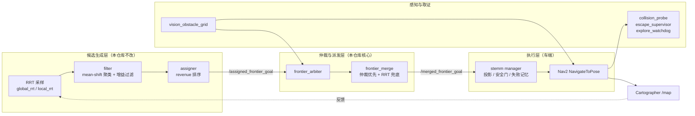

# Exploration

**面向家庭与中小型厂房的室内 SLAM 自主探索建图 —— 消费级算法落地的仿真验证仓库。**

本仓库把一套实车在用的 `Cartographer 2D + Nav2 + RRT 前沿` 链路完整搬进 Gazebo，
让**同一份算法代码**在确定性、可复现的条件下反复运行，用来回答一个很具体的工程问题：

> 这套东西在真实场景里会不会崩？崩在哪？改完之后还崩不崩？

---

## 这不是什么

说清楚边界，比罗列功能更重要：

| 不是 | 原因 |
|---|---|
| ❌ 算法研究仓库 | 不做"更优的收益函数 / 更快的采样器"。目标是**消费级算法的落地稳定性**，不是 SOTA |
| ❌ 新仿真器 | 只用 Gazebo Classic，不自研物理与渲染 |
| ❌ 车端代码仓库 | 车端（实机）源码在独立仓库；本仓库对它**只做 launch 级参数注入**，且逐字节可还原 |
| ❌ 一次性 demo | 结论必须来自 ≥10 轮 A/B + 配对 bootstrap，单轮结果不作为结论 |

**技术选型的立场**：SLAM 用 2D Cartographer、导航用 Nav2、感知是激光为主 + 深度补盲。
这套组合是为**家庭 + 部分厂房**场景选的——不是为无人机 3D 探索、也不是为高动态室外设计。

---

## 能力状态

诚实区分"已实现并验证"与"没做"，是这份 README 最重要的一张表。

| 能力 | 状态 | 依据 |
|---|---|---|
| Cartographer 2D 探索建图（Gazebo，与车端同栈） | ✅ 已验证 | 本地累计 900+ 轮实验 |
| Nav2 全链路（BT / MPPI / 多层代价地图 / 生命周期） | ✅ 已验证 | 每轮 11 项自动验收 |
| 前沿候选可执行性仲裁（净宽 / 逃逸方向 / 死口袋 / 沿路窄段） | ✅ 已验证 | `docs/P13_实施说明.md` §15.8 |
| 派发通道治理（把 manager 自采样收回仲裁） | ✅ 已验证 | 自采样占比 27% → 1%（`P7`） |
| 后置纠偏（GoalUpdater 原地改向，不平白取消目标） | ✅ 已验证 | 取消率 76.4% → 42.9%（`P13` §15.14） |
| 幻影到达审计（识别"30 ms 就报到达"的物理不可能事件） | ✅ 已验证 | 79.2% → 0（46 条到达，0 幻觉） |
| 深度相机视觉障碍层（补 2D 雷达盲区） | ✅ 已验证 | `VISION_方案A落地记录.md` |
| 撞障 / 后退 / 静止三类行为的独立取证 | ✅ 已验证 | `collision_probe` / `escape_supervisor` / `explore_watchdog` |
| **区域级（几何分解）调度** | ⏳ **规划中** | 见 `docs/S5_构型无关适配层_实施计划.md` |
| **全向 / 阿克曼构型适配** | ⏳ **规划中** | 当前只验证了**两轮差速**一种构型 |
| 可导航覆盖率收敛判据 | ⏳ **规划中** | 目前收敛判据仍是"无前沿" |
| 跨会话地图续建 / 多会话合并 | ❌ 未实现 | 单会话模型，大场景需要 |
| 真实机器人端到端验证 | ❌ 未验证 | 全部结论来自仿真 |

> **关于"通用性"**：架构上已按"构型无关"预留（阈值可参数化、运动能力用 flag 表达），
> 但**目前只有两轮差速构型被实测验证**。在三种构型都跑完 10 轮验收前，
> 本仓库不会宣称"支持全构型"。

---

## 技术栈

| 项 | 版本 / 说明 |
|---|---|
| ROS | ROS 2 Humble |
| 仿真器 | Gazebo Classic 11 |
| SLAM | Cartographer 2D |
| 导航 | Nav2 1.1.20（含一个上游缺陷修复，见下） |
| 场景 | `aws_small_house.world`（AWS RoboMaker 小户型，约 12 × 19 m） |
| 机器人 | 两轮差速，footprint 0.50 × 0.40 m（含轮外廓 0.47 m），最大速度 ~0.5 m/s |
| 感知 | 2D 激光（360°）+ 深度相机视觉障碍层（默认开启） |
| 空间计算 | `numpy` / `scipy.ndimage`（距离场、连通分量、几何分解） |

**Nav2 上游缺陷修复**：`GoalUpdater` 节点的 `last_goal_received_` 是实例成员，
不随 `NavigateToPose` 目标重置；一次原地更新会污染后续所有目标
（`ComputePathToPose` 规划到机器人自身位置 → 收到目标后 30 ms 就报"到达"）。
补丁见 `docs/patches/nav2_goalupdater_fix.patch`。

---

## 系统架构



**分层职责**是这套系统能被分析、被修改的根本原因：

| 层 | 负责 | 不该做的事 |
|---|---|---|
| 候选生成层 | RRT 采样、聚类、过滤、粗排 | 不知道下游能否执行 |
| 仲裁与派发层 | 可执行性判定、风险评分、通道治理、后置纠偏 | **不回头改生成策略** |
| 执行层 | 运动规划、控制、安全闸、脱困 | 不做候选筛选 |

---

## 核心组件

`src/stemm_cartographer_exploration_sim/scripts/`（13 个节点，Python，无扩展名）

| 节点 | 作用 |
|---|---|
| **`frontier_arbiter`** | **核心仲裁**：可达性预筛、沿路径净宽测量、逃逸方向、风险评分、候选排序、后置纠偏、观测落盘（~4600 行） |
| `frontier_merge` | 仲裁目标优先（带 TTL），到期回落 RRT 原始样本作兜底 |
| `vision_obstacle_grid` | 深度相机 → 视觉障碍栅格 → 局部体素层 + 全局只增障碍层 |
| `collision_probe` | 撞障取证：底盘/轮接触、雷达近距点、非受控倒车，全程只读 |
| `escape_supervisor` | 雷达引导的脱困（只允许旋转 + 前进），禁止非受控硬倒车 |
| `explore_watchdog` | 探索进度看门狗：静止归因、无净进展判定、返航期专用分支 |
| `session_driver` | 单轮会话驱动：到点结束建图、触发返航、收尾 |
| `patch_sim_time` | 运行期给车端节点补齐 `use_sim_time` / footprint / 容差等参数 |
| `nav_plan_audit` / `nav2_lifecycle_nudge` | 规划失败审计、Nav2 生命周期兜底 |
| `wait_robot_ready` | 起栈就绪门控 |
| `fake_base` / `sim_shims` / `urdf_publisher` | 仿真适配垫片 |

---

## 四条关键设计决策

这四条是踩过坑之后定下来的，比任何参数都重要。

### 1. 只排序，不改生成

候选**生成**（RRT 采样、前沿提取、过滤）与候选**排序/仲裁**严格分层。
排序层可以任意重排、降级、否决，但**不允许回头改生成策略**——
否则无法归因到底是采样变好还是排序变好。

### 2. 新功能默认关闭

所有新增打分项、阶段机、准入判据，默认值必须**等价于改造前行为**。
A/B 时用开关打开，这样基准臂与改造臂跑的是**同一份代码**，
避免"两个版本差异"污染结论。

### 3. 退化先回滚

任何改动若在 10 轮 A/B 中造成停滞 / 覆盖 / 接触任一项退化，**先回滚再分析**，
不在"半好半坏"状态下继续叠加改动。

> 这条有实际代价：`P6_V1候选闸门验证报告.md` 里，候选择优闸门让静默静止 12→12
> （无改善），却带来 442 次/轮的 churn 和 3 轮返航失败，最终默认关闭。
> **记录失败和记录成功一样重要。**

### 4. 探针优先

改打分逻辑前先补探针（候选池快照、派发特征、判决记录、时间线）。
没有归因数据的改动，退化时只能看到"停滞变长了"，无法定位。

---

## 实验方法论

单轮方差极大，这是本仓库最重要的一条经验：**5 轮以内经常得出相反结论**
（实测组内覆盖率极差可达 30 pt）。

| 手段 | 做法 |
|---|---|
| 确定性启动 | `harness/round.sh`：固定起栈顺序 + 就绪门控 + PGID 收尾 + 零残留取证 |
| 单轮约 8 分钟 | 180 s 探索 + 起栈 + 返航 + 收尾 |
| 并发保护 | `/tmp/stemm_round.lock` 文件锁，同刻只允许一轮（防数据污染） |
| DDS 隔离 | 默认 `ROS_LOCALHOST_ONLY=1` + 独立 `ROS_DOMAIN_ID`，不受网络环境影响 |
| 最少 10 轮/组 | 交错执行（a1 b1 a2 b2…）天然配对 |
| 统计口径 | 中位数 + 95% bootstrap CI（1000 次重采样）+ **配对** bootstrap |
| 不报均值±标准差 | 分布明显非正态，且有小样本离群 |

失败必须能被**归类**，而不是只能说"这轮失败了"。
`harness/analyze_dispatch_risk.py` 把每个派发按坐标配对到终态，
并剔除"物理不可能"的幻影到达后再算取消率——否则会得出方向相反的假结论。

---

## 关键实测结果

数字来自本仓库已有实验文档，**跨批次不可直接横向比较**（基线不同）。

### 探索段（S1~S4 全链条，vs 最初基线，10+10 轮配对 bootstrap）

| 指标 | 初始 | 最终 | 判定 |
|---|---|---|---|
| 取消率 | 76.40% | **42.90%** | 显著改善，CI [−53.05, −17.55] |
| 选点等待占比 | 38.6% | **18.2%** | −53% |
| 派发距离中位 | 4.61 m | **3.61 m** | 显著变近 |
| 目标存活中位 | 6.0 s | **18.4 s** | +207% |
| 已知覆盖 | 61431 格 | 63180 格 | 无显著差异 |
| 行驶里程 | 25.47 m | 32.01 m | **显著增加（代价）** |

代价说明：放开 `[0.58, 0.92)` 的窄通道后，车确实会开进窄处，
但窄处紧贴已知墙，往往不产生新覆盖——这是"减少等待"的真实成本。

### 过程量

| 指标 | 旧 | 新 |
|---|---|---|
| 走廊硬门否决 / 轮 | 1589.5 | **269.0（−83%）** |
| 窄但放行 / 轮（新增供给） | — | 223.5 |
| manager 自采样占比 | 27% | **1%** |
| 原地改向 / 轮（替代取消重派） | 0 | 2.5 |
| 幻影到达 | 79.2% | **0** |

### 四组负面结果（同样重要）

| 实验 | 改动 | 结果 |
|---|---|---|
| V1 候选闸门 | 加"逃逸方向 / 连通块"硬门 | 静默静止 12→12，PASS 10/10→**7/10**，返航失败 0→3 → **默认关闭** |
| 供给放开 | 三处硬门改软约束，候选供给放开 3 个数量级 | 派发量 32.6 → **32.4（纹丝不动）** |
| 跨层判决传递 | 把可行性判决传给导航层 | 供给 −36%、覆盖显著变少；质量指标 4 项全无显著差异 |
| 判决判据标定 | 逃逸方向门限从 3 下调到 0 | 四个臂的 `feasible` **全为 0**（负判决在硬门之间守恒转移） |

**结论**：在这条链路上，**瓶颈不在候选供给量**。只改评分、只放宽门限、
只传判决，都无法改善派发质量。

---

## 验收标准

每轮由 `harness/evaluate.py` 自动判定，共 **11 项**：

| 项 | 判据 |
|---|---|
| `preflight` | 起栈前置检查通过 |
| `tf_healthy` | TF 链路健康，无超时 |
| `nav2_active` | Nav2 四节点全部 ACTIVE |
| `frontier` | 确实发生了前沿探索（有有效派发） |
| `mapping_done` | 到点正确触发 `set_mapping_done` |
| `return_home` | 返航完成 |
| `map_saved` | 地图成功存盘 |
| `no_contact` | 物理接触为 0（底盘/轮） |
| `no_reverse` | 非受控硬倒车为 0 次 |
| `vision_cells` | 视觉障碍栅格正常输出 |
| `vision_layer_ok` | 视觉图层已正确注入代价地图插件链 |

另：每轮收尾要求 `gzserver=0` 且无进程残留。

---

## 目录结构

```
├── src/stemm_cartographer_exploration_sim/
│   ├── scripts/            # 13 个节点（Python，无扩展名）
│   ├── launch/             # sim_explore.launch.py 为主入口（另有 nav_only / nav_sim / nav_verify）
│   └── config/             # sim_explore_params.yaml、sim_vision.rviz
├── harness/                # 110+ 实验与取证脚本
│   ├── round.sh            # ★ 单轮运行器（确定性启动 + 收尾 + 验收）
│   ├── evaluate.py         # 11 项自动验收
│   ├── metrics.py / report.py / time_breakdown.py
│   ├── analyze_dispatch_risk.py   # 派发→终态配对、幻影剔除
│   ├── p13_stats.py        # 配对 bootstrap
│   ├── smoke_check.sh      # 起栈冒烟（含离线静态断言）
│   ├── test_*.py           # 20 个离线回归测试（<1 s 级）
│   └── analyze_*.py        # 10 个归因分析脚本
├── docs/                   # 阶段实施方案与实验报告（含 patches/ 与论文计划）
├── patches/                # 对车端仓库的补丁（pristine 基线不入库，可重建）
├── runs/                   # 单轮摘要 JSONL（运行产物，不入库）
├── logs/                   # 每轮实验产物（体积大，不入库）
└── shots/                  # 关键证据截图
```

---

## 快速开始

### 环境准备

本仓库依赖**多个叠加工作空间**，需按顺序 source（后者覆盖前者）：

```bash
# 1. 基础仿真环境（域隔离 + Gazebo + 通用依赖）
source $HOME/stemm_sim_ws/domain_guard.sh      # 设定 ROS_DOMAIN_ID 隔离
source /opt/ros/humble/setup.bash
source $HOME/stemm_sim_ws/install/setup.bash

# 2. 探索专用依赖
source $HOME/stemm_explore_ws/install/setup.bash

# 3. 本仓库
source $HOME/stemm_exploration_sim_ws/install/setup.bash

# 4. 车端仓库（可选，用于覆盖特定包，如修补后的 nav2_behavior_tree）
[ -f $HOME/wheeltec_ros2/install/setup.bash ] && \
    source $HOME/wheeltec_ros2/install/setup.bash
```

> 路径按实际部署调整。`harness/round.sh` 顶部已封装上述顺序，
> 并额外处理三件容易踩的事：强制 `ROS_LOCALHOST_ONLY=1`、
> 每轮前 `ros2 daemon stop`、文件锁防并发。

### 编译

```bash
cd <本仓库根目录>
colcon build --symlink-install
```

Python 节点走 `--symlink-install`，改 `.py` 后**无需重新编译**即可生效。

### 跑一轮

```bash
./harness/round.sh <标签> <探索秒数>
# 例：
./harness/round.sh baseline 180
```

产物：

- `logs/round_<时间戳>_<标签>/report.md` —— 单轮体检报告
- `logs/round_<时间戳>_<标签>/launch.log` —— 全量日志
- `logs/round_<时间戳>_<标签>/cand_pool.jsonl` —— 候选池快照
- `logs/round_<时间戳>_<标签>/timeline.jsonl` —— 1 Hz 级时间线
- `runs/<时间戳>-<标签>.jsonl` —— 单轮摘要

### 跑 A/B

```bash
for i in $(seq 1 10); do VAR_A=0 ./harness/round.sh myexp_a 180; done
for i in $(seq 1 10); do VAR_A=1 ./harness/round.sh myexp_b 180; done

python3 harness/p4_ab.py myexp_a myexp_b                                   # 机制归因
python3 harness/p13_stats.py 'logs/round_*myexp_a*' 'logs/round_*myexp_b*' # 配对 bootstrap
```

---

## 文档索引

按"问题 → 根因 → 改动 → A/B → 残留"结构归档：

| 文档 | 主题 |
|---|---|
| `EXPLORATION_SIM_验收记录.md` | 仿真接入的稳定性验收 |
| `P0_脱困与撞障治理.md` / `P0_验收记录.md` | 卡死与撞障（含 footprint 补宽根因） |
| `P1_候选生成缺陷清单.md` | 候选生成链路的缺陷清单（含走廊测宽几何错误） |
| `P5_候选生成优化方案.md` / `P6_V1候选闸门验证报告.md` | 候选闸门（含一次完整回滚） |
| `P7_V2通道治理验证报告.md` | 把 manager 自采样收回仲裁 |
| `P8` / `P9` | 观测工作流、AB 实验协议 |
| `P10_地图行序镜像_根因与归档.md` | 地图保存镜像根因 |
| `P12_后置纠偏_GoalUpdater方案.md` | 后置纠偏与 BT 跨目标污染 |
| `P13_基线.md` / `P13_实施说明.md` / `P13_文献调研.md` | 派发质量基线、S1~S4 全过程、文献核验 |
| `P14_候选落点倾向.md` | 先远后近两阶段排序（**已实现，默认关闭，未通过验收**） |
| `S5_构型无关适配层_实施计划.md` | 构型无关适配 + 几何分解区域调度（**计划，未实施**） |
| `VISION_方案A落地记录.md` | 深度相机视觉障碍层 |
| `WORKFLOW.md` | 完整实验工作流与观测字段口径 |
| `patches/nav2_goalupdater_fix.patch` | Nav2 上游缺陷修复 |

根目录的 `P0~P6`、`PROGRESS_*`、`S0_*` 是更早期的阶段记录，保留备查。

---

## 已知限制

按严重程度排序，不隐瞒：

1. **返航尚未稳定通过。** 最近 10 轮（`p13s4_g`）全流程判定**全部 FAIL 于 `return_home`**；
   探索段指标可用，但"全流程可用"不成立。这是当前最大未解缺陷。
2. **P14（先远后近）未通过验收。** 已实现且默认关闭（`frame_far_first=false`），
   实测出现接触事件，根因与"未知连通分量退化"有关（最大分量占 91.4%）。
3. **单一世界。** 全部实验在 `aws_small_house.world` 完成，异世界泛化未验证。
4. **只有两轮差速一种构型。** 全向与阿克曼仅有架构预留，无实测。
5. **无真机端到端验证。** 所有结论来自 Gazebo + 离线仿真与日志分析。
6. **部分路径硬编码。** `harness/` 与 `patches/` 中有绝对路径引用，移植时需调整。
7. **`patches/` 中的 pristine 文件不入库**（`.gitignore` 排除），需按脚本重建。

---

## 约定

- 任何改动都要**可回退**（哨兵注释 + journal + 逐字节还原，或单一开关）。
- 任何退化立即回退，并写明"试了什么、为什么退"。
- 不编造数字；拿不到就写"未验证"。
- **禁止为验证而向实物机器人发布运动指令**。本仓库的一切实验在仿真中完成。

---

## 相关仓库

- **车端（实机）仓库**：Nav2 / Cartographer / 传感器驱动 / 底盘控制。
  本仓库通过 `patches/` 与 launch 级参数注入对其做最小侵入式改动，
  并在最后 `source` 车端 overlay 让修补后的包覆盖系统版本。

---

## 许可

本仓库为内部开发实验仓库，未公开发布许可。
引用的第三方组件（Nav2、Cartographer、Gazebo、AWS RoboMaker 场景等）遵循其各自许可。
