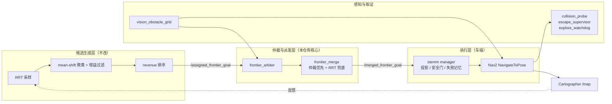

# Exploration

**室内 SLAM 自主探索建图 —— 在真机标定的仿真模型上，做消费级算法落地的验证。**

一套实车在用的 `Cartographer 2D + Nav2 + RRT 前沿` 链路，配上**按一台在役商用两轮差速底盘实测反推**
的仿真机器人模型。用来回答一个很具体的工程问题：

> 这套东西在真实场景里会不会崩？崩在哪？改完之后还崩不崩？

---

## 这个仓库在做什么

**作用**：把一个只能"上真车试"的探索建图链路，变成**可确定性复现**的实验台。
同一份算法代码、同一个标定过的机器人模型、同一套自动验收，反复跑。

**方向**：不是提出更好的前沿检测算法，而是把**"候选能不能被执行"**这件事测准、测全、测得可归因。
目标场景是**家庭与中小型厂房**，所以选型是 2D 激光 SLAM + Nav2 + 深度补盲——
不为无人机 3D 探索设计，也不为高动态室外设计。

**痛点 → 实验**：三个痛点，三组实验。

| 痛点 | 现象 | 我们做了什么 |
|---|---|---|
| 候选点派出去就到不了 | 目标存活中位只有 6 秒，大量目标在 0.2 秒内被自己撤销 | 逐条给派发配终态、剔除幻影"到达"，重新定义取消率与存活时长 |
| 调参调不动 | 三处硬门改软约束，候选供给放开 **3 个数量级**，派发量 32.6 → **32.4** | 用 4 组负面结果定位真瓶颈：不在供给侧 |
| 以为是权重问题，其实是测量问题 | 斜走廊宽度被高估 1.41 倍，前沿点系统性低估 | 把"能不能过"从人为设定的标量改成几何测量，取消率 **76.4% → 42.9%** |

---

## 关键发现

结论比过程重要，先放这里。所有数字来自 ≥10 轮交错 A/B + 配对 bootstrap（1000 次重采样）。

**① 供给侧放开三个数量级，派发量纹丝不动。**

| 指标 | 改前 | 改后 |
|---|---|---|
| `route_soft_pass`（通过率） | 0 | **991 / 轮** |
| 实际派发 / 轮 | 32.6 | **32.4** |

候选从来不是瓶颈。**只改评分、只放宽门限，等于没改。**

**② 79.2% 的"到达"是物理不可能事件。**

基线 286 次配对派发里，226 次报 `reached`，其中 **179 次是 30 ms 内完成**
（对 5.456 m 的目标，隐含速度 182 m/s）。根因是 Nav2 `GoalUpdater` 节点的
`last_goal_received_` 是实例成员、不随导航目标重置 —— 一次原地更新会污染后续所有目标。
修复后 46 条到达，**幻觉 0 条**。

> 这个缺陷意味着：**没做过这层审计的 Nav2 实验，报的"到达率"可能有系统性偏差。**

**③ 判决判据在目标分布上没有区分度。**

把"逃逸方向数"门限从 3 一路下调到 0（等于关掉这条判据），四个臂的 `feasible` **全为 0**，
9 项质量指标配对 bootstrap **全部无显著差异**。原因是负判决在硬门之间**守恒转移**：

| 负判决 | esc=3 | esc=0 |
|---|---|---|
| `dead_end` | 248 | 0 |
| `too_narrow` | 17 | 161 |
| `unreachable` | 7 | 69 |
| **合计** | **272** | **230** |

不是门限设错了，是**判据测错了对象**。

**④ 换成几何测量之后，指标才真的动了。**

10+10 轮配对 bootstrap，vs 最初基线：

| 指标 | 初始 | 最终 | 判定 |
|---|---|---|---|
| 取消率 | 76.40% | **42.90%** | 显著，CI [−53.05, −17.55] |
| 选点等待占比 | 38.6% | **18.2%** | −53% |
| 派发距离中位 | 4.61 m | **3.61 m** | 显著变近 |
| 目标存活中位 | 6.0 s | **18.4 s** | +207% |
| 已知覆盖 | 61431 格 | 63180 格 | 无显著差异 |
| 行驶里程 | 25.47 m | 32.01 m | **显著增加（代价）** |

代价是真的：放开窄通道后车会开进去，但窄处紧贴已知墙，往往不产生新覆盖。

**⑤ 修 bug 不够，还得把"谁有权派"收回来。**

车端 manager 有自己的兜底采样器，会绕过仲裁直接派目标 —— 占派发的 **27%**，
而实测卡死目标里 **62%** 出自这条路径。给它注入等待窗口后，自采样降到 **1%**，
卡死从 12 次降到 9 次。

---

## 仿真模型：从一台在役商用底盘实测反推

**这一节是全部结论可信度的地基。**

厂商提供的 URDF **不能当基准**。车端仓库里有 50 个厂商模板 URDF，同一车型的三个变体
质量差 **3 kg**、相机高度差 **9 cm** —— 只能说明这些是按机型/选配件填的模板值。

所以这台仿真机器人是**用真机数据反推出来的**：外壳几何实测 + 执行器实测 + 传感器真实数据。

### 被真机实测替换掉的关键项

| 项 | 交付包原值（假设） | 真机实测（已替换） |
|---|---|---|
| 轮轴纵向位置 | "暂放底盘前后中心" | 底盘前缘 → 轮轴中心 = **0.29 m**（轮轴在几何中心之后 0.065 m） |
| 后从动轮 | 有一个 | **删除**（真机后方没有从动轮） |
| 雷达 / 相机 x | 由前缘后 0.05 推 0.175 | **0.24 m**（与实测"轮轴→雷达 24 cm"一致） |
| 底盘 | — | 长 0.45 × 宽 0.36 × 厚 0.06，底面离地 0.08 |
| 驱动轮 | — | 直径 0.20、厚 0.05、轮心距 0.41、含轮总宽 **0.46** |
| 雷达 | — | 扫描面离地 0.225；**盲区 110°–240°** 复刻真机 |
| 相机 | — | 光心离地 0.26，位于雷达正上方 |

坐标系原点 = **轮轴中心的地面投影**（与差速里程计积分点一致）。

### 执行器与里程计标定

| 项 | 真机实测 | 模型处理 |
|---|---|---|
| 里程计频率 | **20.000 Hz**（配置写 30/50 都不对） | 按 20 Hz 发布 |
| 里程计协方差 | `[1e-9, 1e-3, 1e6, 1e6, 1e6, 1e-9]` | 逐项照抄 |
| 转向闭合误差 | 转 5 整圈（真值 1800°）底盘只报 **1680.45°**（少 6.6%） | 记录在案；轮距仍取几何权威值 0.41（按误差改 0.3828 经查方向存疑，已回退） |
| 指令超时 | 指令流中断 **1.6 s** 内底盘仍保持上一条指令 | 配 1.5 s |
| 里程计来源 | 编码器反馈 | `open_loop: false`（打滑时里程计会真的漂，不假装没打滑） |

### 模型验证（141 项，全部通过）

- **几何**：`0.45 × 0.36 × 0.06`，轮心距 0.41，含轮总宽 0.46 ✓
- **雷达自过滤**：100 帧、166 700 个有效回波，**0 个落在车体内** ✓
- **停车**：静止 / 直行 / 转向 / 停转四类工况 ✓
- **走廊**：0.35 m 用例通过；**0.60 m 用例未通过**（规划失败 6 次）—— 已知边界，保留记录

> 一句话：这台车**不是"长得像"的仿真机器人，是"测出来的"仿真机器人**。
> 所有几何与运动学阈值（含可通行净宽）都建立在这批实测值上。

---

## 怎么保证结论可信

单轮方差极大，这是本仓库最贵的一条经验：**5 轮以内经常得出相反结论**
（实测组内覆盖率极差可达 30 pt）。

| 手段 | 做法 |
|---|---|
| 确定性启动 | 固定起栈顺序 + 就绪门控 + PGID 收尾 + 零残留取证，单轮约 8 分钟 |
| 环境隔离 | `ROS_LOCALHOST_ONLY=1` + 独立 `ROS_DOMAIN_ID` + 每轮前 `ros2 daemon stop` |
| 并发保护 | 文件锁，同刻只允许一轮（防两轮互相污染指标） |
| 样本量 | **≥10 轮/组**，交错执行（a1 b1 a2 b2…）天然配对 |
| 统计 | 中位数 + 95% bootstrap CI（1000 次重采样）+ **配对** bootstrap |
| 不报均值±标准差 | 分布非正态，且有小样本离群 |

失败必须能**归类**，而不是只能说"这轮失败了"。
`analyze_dispatch_risk.py` 把每个派发按坐标配到终态，
并剔除"物理不可能"的幻影到达后再算取消率 —— 不剔除会得出方向相反的假结论。

---

## 四条不能破的规矩

### 1. 只排序，不改生成

候选**生成**（RRT 采样、前沿提取、过滤）与候选**排序/仲裁**严格分层。
排序层可以任意重排、降级、否决，但**不回头改生成策略**——
否则无法归因到底是采样变好还是排序变好。

### 2. 新功能默认关闭

新增打分项、阶段机、准入判据，默认值必须**等价于改造前行为**。
A/B 时用开关打开，这样基准臂与改造臂跑的是**同一份代码**。

### 3. 退化先回滚

10 轮 A/B 里任一项退化，**先回滚再分析**，不在"半好半坏"状态下继续叠加。

> 有实际代价：候选择优闸门让静默静止 12→12（无改善），却带来 442 次/轮的 churn
> 和 3 轮返航失败，最终默认关闭。**记录失败和记录成功一样重要。**

### 4. 探针优先

改打分逻辑前先补探针（候选池快照、派发特征、判决记录、时间线）。
没有归因数据的改动，退化时只能看到"停滞变长了"，无法定位。

---

## 系统架构



分层职责是这套系统能被分析、被修改的根本原因：

| 层 | 负责 | 不该做的事 |
|---|---|---|
| 候选生成层 | RRT 采样、聚类、过滤、粗排 | 不知道下游能否执行 |
| 仲裁与派发层 | 可执行性判定、风险评分、通道治理、后置纠偏 | **不回头改生成策略** |
| 执行层 | 运动规划、控制、安全闸、脱困 | 不做候选筛选 |

### 核心组件

`src/stemm_cartographer_exploration_sim/scripts/`（13 个节点）

| 节点 | 作用 |
|---|---|
| **`frontier_arbiter`** | 核心仲裁：可达性预筛、沿路径净宽测量、逃逸方向、风险评分、排序、后置纠偏、观测落盘 |
| `frontier_merge` | 仲裁目标优先（带 TTL），到期回落 RRT 原始样本兜底 |
| `vision_obstacle_grid` | 深度相机 → 视觉障碍栅格 → 局部体素层 + 全局只增障碍层（治 2D 雷达盲区） |
| `collision_probe` | 撞障取证：底盘/轮接触、雷达近距点、非受控倒车，全程只读 |
| `escape_supervisor` | 雷达引导脱困（只允许旋转 + 前进），禁止非受控硬倒车 |
| `explore_watchdog` | 静止归因、无净进展判定、返航期专用分支 |
| `session_driver` | 单轮会话驱动：到点结束建图、触发返航 |
| `patch_sim_time` | 运行期给车端节点补齐 `use_sim_time` / footprint / 容差 |
| `nav_plan_audit` / `nav2_lifecycle_nudge` / `wait_robot_ready` | 规划审计、生命周期兜底、起栈门控 |
| `fake_base` / `sim_shims` / `urdf_publisher` | 仿真适配垫片 |

### 技术栈

| 项 | 版本 / 说明 |
|---|---|
| ROS / 仿真 | ROS 2 Humble / Gazebo Classic 11 |
| SLAM / 导航 | Cartographer 2D / Nav2 1.1.20（含上述上游缺陷修复） |
| 场景 | `aws_small_house.world`（约 12 × 19 m） |
| 机器人 | 两轮差速，按真机实测标定，含轮 0.46 m 宽 |
| 感知 | 2D 激光（360°，复刻真机盲区）+ 深度相机视觉障碍层 |

---

## 快速开始

### 环境

本仓库依赖**多个叠加工作空间**，按顺序 source（后者覆盖前者）：

```bash
source $HOME/stemm_sim_ws/domain_guard.sh      # ROS_DOMAIN_ID 隔离
source /opt/ros/humble/setup.bash
source $HOME/stemm_sim_ws/install/setup.bash   # 标定过的机器人模型 + Gazebo
source $HOME/stemm_explore_ws/install/setup.bash
source $HOME/stemm_exploration_sim_ws/install/setup.bash
# 可选：车端 overlay（覆盖修补后的 nav2_behavior_tree）
[ -f $HOME/wheeltec_ros2/install/setup.bash ] && source $HOME/wheeltec_ros2/install/setup.bash
```

`harness/round.sh` 顶部已封装上述顺序，并额外处理三件容易踩的事：
强制 `ROS_LOCALHOST_ONLY=1`、每轮前 `ros2 daemon stop`、文件锁防并发。

### 编译与运行

```bash
colcon build --symlink-install        # Python 节点改完无需重编

./harness/round.sh baseline 180       # 单轮：180 s 探索，约 8 分钟
```

产物：`logs/round_<时间戳>_<标签>/`（`report.md` 体检报告、`launch.log`、
`cand_pool.jsonl` 候选池快照、`timeline.jsonl` 时间线）+ `runs/*.jsonl` 单轮摘要。

### A/B

```bash
for i in $(seq 1 10); do VAR_A=0 ./harness/round.sh myexp_a 180; done
for i in $(seq 1 10); do VAR_A=1 ./harness/round.sh myexp_b 180; done

python3 harness/p4_ab.py myexp_a myexp_b                                   # 机制归因
python3 harness/p13_stats.py 'logs/round_*myexp_a*' 'logs/round_*myexp_b*' # 配对 bootstrap
```

### 验收

每轮由 `harness/evaluate.py` 自动判定 **11 项**：
`preflight`、`tf_healthy`、`nav2_active`、`frontier`、`mapping_done`、`return_home`、
`map_saved`、`no_contact`、`no_reverse`、`vision_cells`、`vision_layer_ok`。
另要求收尾 `gzserver=0` 且无进程残留。

---

## 能力状态

诚实区分"已验证"与"没做"。

| 能力 | 状态 |
|---|---|
| Cartographer 2D 探索建图（Gazebo，与车端同栈） | ✅ 已验证 |
| Nav2 全链路 + 11 项自动验收 | ✅ 已验证 |
| 候选可执行性仲裁（净宽 / 逃逸方向 / 死口袋 / 沿路窄段） | ✅ 已验证 |
| 派发通道治理（把 manager 自采样收回仲裁） | ✅ 已验证 |
| 后置纠偏（GoalUpdater 原地改向，不平白取消目标） | ✅ 已验证 |
| 幻影到达审计 | ✅ 已验证 |
| 深度相机视觉障碍层 | ✅ 已验证 |
| 撞障 / 后退 / 静止三类行为独立取证 | ✅ 已验证 |
| 区域级（几何分解）调度 | ⏳ 规划中 |
| 全向 / 阿克曼构型适配 | ⏳ 规划中，**当前只有差速被实测** |
| 可导航覆盖率收敛判据 | ⏳ 规划中，当前收敛判据仍是"无前沿" |
| 跨会话地图续建 | ❌ 未实现（单会话模型） |
| 真机端到端验证 | ❌ 未验证 |

> **关于"通用性"**：架构按"构型无关"预留（阈值由车体几何派生、运动能力用 flag 表达），
> 但**只有两轮差速构型被实测验证**。三种构型跑完 10 轮验收前，不宣称"支持全构型"。

---

## 已知限制

按严重程度排序，不隐瞒：

1. **返航尚未稳定通过。** 最近 10 轮全流程判定**全部 FAIL 于 `return_home`**。
   探索段指标可用，但"全流程可用"不成立 —— 当前最大未解缺陷。
2. **"先远后近"排序未通过验收。** 已实现但默认关闭，实测出现接触事件。
   根因与"未知连通分量退化"有关（最大分量占 91.4%），需改用几何分解。
3. **单一世界。** 全部实验在 `aws_small_house.world` 完成，异世界泛化未验证。
4. **只有两轮差速一种构型。**
5. **无真机端到端验证。** 所有结论来自 Gazebo + 离线仿真与日志分析。
6. **模型质量/惯量为估计值。** 几何与运动学是实测，质量与转动惯量尚未称重标定。
7. **部分路径硬编码。** `harness/` 与 `patches/` 中有绝对路径引用。

---

## 文档索引

按"问题 → 根因 → 改动 → A/B → 残留"结构归档：

| 文档 | 主题 |
|---|---|
| `docs/探索建图_现状与设计框架.md` | **整体设计框架**（架构、分层、参数面、数据流） |
| `docs/P13_实施说明.md` | **主线全过程**：宽度测量修正 / 窄道硬门拆分 / 原地改向（S1~S4）与全部 A/B 数据 |
| `docs/P13_基线.md` | 派发质量基线（含幻影到达的定义与剔除口径） |
| `docs/P13_文献调研.md` | 7 个开源工作的跨层判决传递核验 |
| `docs/P7_V2通道治理验证报告.md` | 把 manager 自采样收回仲裁（27% → 1%） |
| `docs/P12_后置纠偏_GoalUpdater方案.md` | 后置纠偏与 BT 跨目标污染 |
| `docs/P14_候选落点倾向.md` | 先远后近排序（已实现，未通过验收） |
| `docs/S5_构型无关适配层_实施计划.md` | 构型无关适配 + 几何分解区域调度（计划，未实施） |
| `P1_候选生成缺陷清单.md` | 候选生成链路缺陷（含走廊测宽几何错误） |
| `P6_V1候选闸门验证报告.md` | 一次完整的正面实验 + 回滚 |
| `VISION_方案A落地记录.md` | 深度相机视觉障碍层 |
| `docs/patches/nav2_goalupdater_fix.patch` | Nav2 上游缺陷修复 |
| `docs/WORKFLOW.md` | 实验工作流与观测字段口径 |

根目录 `P0~P5`、`PROGRESS_*`、`S0_*` 是更早期的阶段记录，保留备查。

---

## 目录结构

```
├── src/stemm_cartographer_exploration_sim/
│   ├── scripts/            # 13 个节点（Python，无扩展名）
│   ├── launch/             # sim_explore.launch.py 为主入口
│   └── config/             # Nav2 / Cartographer / 视觉参数
├── harness/                # 110+ 实验与取证脚本（20 个离线回归测试、10 个归因分析）
├── docs/                   # 阶段实施方案与实验报告
├── patches/                # 对车端仓库的补丁（pristine 基线不入库，可重建）
├── runs/ · logs/ · shots/  # 运行产物与证据（logs/ 体积大，不入库）
```

---

## 约定

- 任何改动都要**可回退**（哨兵注释 + journal + 逐字节还原，或单一开关）。
- 任何退化立即回退，并写明"试了什么、为什么退"。
- 不编造数字；拿不到就写"未验证"。
- **禁止为验证而向实物机器人发布运动指令**。本仓库的一切实验在仿真中完成。

---

## 相关仓库

车端（实机）仓库：Nav2 / Cartographer / 传感器驱动 / 底盘控制。
本仓库通过 `patches/` 与 launch 级参数注入对其做最小侵入式改动，
最后 `source` 车端 overlay 让修补后的包覆盖系统版本。

## 许可

内部开发实验仓库，未公开发布许可。
引用的第三方组件（Nav2、Cartographer、Gazebo、AWS RoboMaker 场景）遵循其各自许可。
