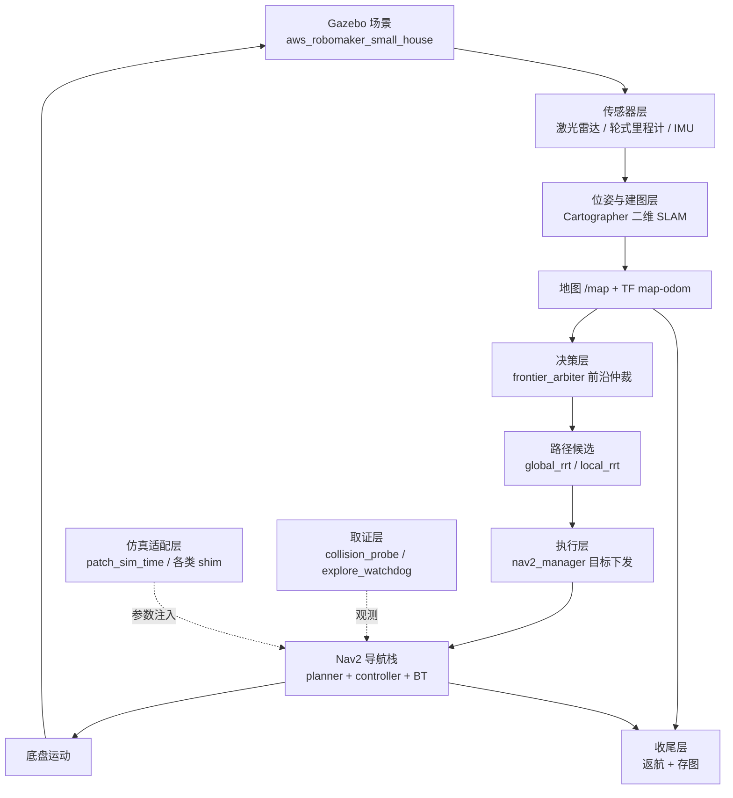

# 探索建图：现状与设计框架（复盘用）

> 更新日期：2026-11-13
> 适用范围：**仅仿真链路**（`stemm_exploration_sim_ws`），不涉及实机部署差异
> 数据来源：`logs/round_*` 实测日志、`src/` 源码、`config/` 参数文件

---

## 1. 一句话定位

一套运行在 Gazebo 小型住宅场景里的**全自主探索建图**链路：
从空白栅格地图出发，自主选择地图边界候选点、逐点推进、最终返回出发点并保存地图。

---

## 2. 整体架构

### 2.1 分层视图



### 2.2 实际运行的节点清单

从 `logs/round_*/launch.log` 实测，单轮启动的节点：

| 分组 | 节点 | 职责 |
|---|---|---|
| 仿真 | `gzserver` / `robot_state_publisher` | 场景与机器人模型 |
| 传感器适配 | `imu_bias_shim` / `scan_deadzone_relay` / `ekf_node` | IMU 偏置、雷达盲区剔除、里程计融合 |
| 建图 | `cartographer_node` / `cartographer_occupancy_grid_node` | SLAM 与栅格发布 |
| 地图服务 | `stemm_cartographer_map_service_adapter` | 地图查询/保存服务封装 |
| 前沿生成 | `frontier_arbiter` / `frontier_merge` | 候选点生成、校验、排序、发布 |
| 路径候选 | `global_rrt` / `local_rrt` / `filter` / `assigner` | RRT 采样、过滤、分配 |
| 运动管理 | `stemm_cartographer_nav2_manager` | 目标下发、到达判定、脱困、返航 |
| Nav2 | `planner_server` / `controller_server` / `behavior_server` / `bt_navigator` / `smoother_server` / `waypoint_follower` / `lifecycle_manager` | 规划、控制、行为树 |
| 安全 | `escape_supervisor` | 停滞检测与脱困动作 |
| 取证 | `collision_probe` | 物理接触、近距告警、倒车统计 |
| 监控 | `explore_watchdog` | 停滞/无目标异常记录 |
| 会话 | `session_driver` / `stemm_cartographer_state_saver` | 时长控制、结束建图、存图 |
| 仿真适配 | `patch_sim_time` | 运行期注入 Nav2 参数（含 footprint） |
| 自检 | `stemm_cartographer_preflight` / `mapping_tf_guard` / `nav2_ready_guard` / `odom_session_guard` | 起栈前置校验 |

### 2.3 关键继承关系（容易踩坑）

```
stemm_nav2_manager/manager.py          class StemmNav2Manager(Node)          ← 基类
        ↑ 继承
cartographer_manager.py                class StemmCartographerNav2Manager   ← 实际运行
```

- 仿真里**只启动** `stemm_cartographer_nav2_manager`（入口 = `cartographer_manager:main`）
- `stemm_nav2_manager` 独立节点**不启动**
- 子类覆盖了 `_dispatch_pending_home_goal` / `goal_result_callback` / `send_nav_goal` /
  `_schedule_return_home_retry` / `start_escape_recovery`，改基类方法时需确认是否被子类拦住

---

## 3. 主流程

### 3.1 探索循环（1 Hz 决策）

```
空白地图
  → frontier_arbiter 从 /map 提取自由-未知边界
  → 逐个候选做通行性校验（带宽、窄段、未知段、转角、净空）
  → 排序（距离折现 + 风险罚分）
  → 发布 /validated_frontier_goal
  → rrt 层分配 → nav2_manager 下发 NavigateToPose
  → 到达/失败 → 重新提取
  → 无候选点 → 结束
```

### 3.2 收尾流程

```
session_driver 到时（默认 180 s）
  → set_mapping_done
  → 结束 Cartographer 轨迹 + 存最终地图
  → 返航（可能分段推进）
  → 到达判定 → 停车 → SIGINT 收栈
```

---

## 4. 各层关键实现

### 4.1 前沿仲裁（`frontier_arbiter`）

| 能力 | 实现要点 |
|---|---|
| 候选生成 | `/map` 上取"紧邻已知空闲的未知格" |
| 通行性校验 | 沿路径测垂直自由带宽，取全程最小值 |
| 硬否决 | 带宽 < `pass_width`、窄段累计超限、连续未知段超限 |
| 软罚分 | 净宽介于 `narrow_floor` 与 `pass_width` 之间 → 降序而非否决 |
| 排序 | 距离折现 + 未知量收益 + 风险罚分 |
| 两阶段 | 框架阶段（先探整体）→ 补齐阶段（补剩余区域），默认关闭 |
| 探针 | 候选池快照写入 `cand_pool.jsonl` |

### 4.2 运动执行（`nav2_manager`）

| 能力 | 实现要点 |
|---|---|
| 目标净空校验 | 目标周围圆盘内无障碍，半径 `goal_clearance`（0.35 m） |
| 起点净空校验 | 出发前确认车能开出去，不足则做一次有界后退 |
| 停滞检测 | 位置/角度无明显变化超过阈值 → 判定卡住 |
| 脱困 | 原地转 → 受控短距退 → 等待净空恢复；禁止长距离倒车 |
| 到达判定 | Nav2 状态 + 位置容差 |

### 4.3 返航（本次重点修改）

| 机制 | 说明 |
|---|---|
| 分段推进 | 距原点 > 2.5 m 时，先走到朝原点方向 2.0 m 处的可站点，逐段推进 |
| 目标朝向 | 指向原点（与行进方向一致），避免终点大角度回转 |
| 几何到位 | 距原点 ≤ 1.5 m 且静止 ≥ 1.5 s → 直接判定完成 |
| 盲走禁止 | 返航段不使用前向/后向盲走逃逸，只允许原地转；在原点容差内首次脱困即放弃 |
| 净空口径 | 返航选点把**未知区域按障碍处理**，与 Nav2 的 `track_unknown_space: true` 对齐 |

### 4.4 取证（`collision_probe`）

| 口径 | 含义 |
|---|---|
| `type=contact` + `src=wheel/chassis` | Gazebo 接触传感器命中的**物理接触**（已过滤地板/地毯） |
| `type=contact` + `src=null` | 雷达近距事件，**不是**物理接触 |
| `type=graze` / `type=alert` | 擦碰/告警，参考项 |
| `physical_contacts` | `chassis_contacts + wheel_contacts`，**验收用这个** |

---

## 5. 当前参数基线

| 项 | 值 | 位置 |
|---|---|---|
| 场景 | `aws_robomaker_small_house` | world 文件 |
| 地图尺寸 | 约 11.7 × 19.3 m（234 × 385 @ 0.05 m） | 运行时地图 |
| 探索时长 | 180 s | `harness/round.sh` |
| 车身外廓 | 0.50 × 0.47 m（含轮） | `patch_sim_time` 运行期注入 |
| 通行净宽门槛 | 0.90 m | `pass_width_m` |
| 物理极限净宽 | 0.58 m | `narrow_floor_m` |
| 转角硬门 | 0.92 m | `corridor_hard_m` |
| 目标净空 | 0.35 m | `goal_clearance` |
| 返航点净空 | 0.80 m | `return_home_goal_clearance` |
| 全局代价地图膨胀 | 0.40 m，未知按障碍 | `global_costmap` |
| 局部代价地图膨胀 | 0.45 m | `local_costmap` |
| 全局规划器 | `SmacPlannerHybrid` + DUBIN（只能前进） | `GridBased` |
| 最小转弯半径 | 0.20 m | `minimum_turning_radius` |
| 角度分箱 | 72 | `angle_quantization_bins` |
| 局部控制器 | `RotationShimController` + `MPPIController` | `FollowPath` |

---

## 6. 开发进度

### 6.1 已完成并验证

| 能力 | 状态 | 依据 |
|---|---|---|
| 自主探索闭环（候选→校验→下发→到达→重选） | ✅ | 多轮实测跑满 180 s |
| 通行性硬否决 + 软罚分分层 | ✅ | 候选池快照与拒绝计数 |
| 探索段多数轮次物理接触为零 | ✅ | 最近 22 轮中 17 轮为 0（非零的 5 轮里有 2 轮是已回退的判据实验） |
| 返航能真正抵达规划目标 | ✅ | 最近 2 轮 `return-home goal reached` |
| 返航不再长时间卡死到超时 | ✅ | 不再出现 `return_home_failed_waiting_manual` 死锁 |
| 地图保存与收栈 | ✅ | 每轮产出 `map.pgm` 约 90 KB |

### 6.2 正在处理

| 问题 | 现状 |
|---|---|
| 探索段偶发轮部接触 | 见第 7.1 节，已定位为**长期存在**的起点旁椅子问题，非本次引入 |
| 返航分段与目标朝向 | 只有 2 轮数据，样本不足 |

### 6.3 尚未验证

| 项 | 说明 |
|---|---|
| 多轮次统计显著性 | 上一次 A/B（10+10 轮）主指标全部不显著 |
| 起点传感器预热超时 | 超时阈值 8 s→20 s 后未做多轮验证 |
| 单元测试 | `test_cartographer_manager.py` 有 30 项历史失败（测试桩缺属性），未逐项排除 |

---

## 7. 已知问题

### 7.1 探索段偶发轮部接触（已查清）

**结论：不是本次改动引入的，是长期存在的场景问题。**

证据一：全历史 463 轮中，75 轮（16%）出现过探索段物理接触，最早可追到 2026-10-26。

证据二：接触位置高度集中。历年记录中反复出现同一坐标带：

```
(0.67,-0.02) (0.72,-0.06) (0.77,-0.08) (0.82,-0.07) (0.94,-0.05)
(0.95,-0.06) (1.19,-0.06) (1.24,-0.38) (1.27,-0.38) (1.32,-0.41)
(1.33,-0.41) (1.35,-0.40)
```

即**出发点东南侧 0.7 ~ 1.4 m、y ≈ 0 ~ -0.4** 的一条带。

证据三：接触对象是 `ChairD_01_002`（起点旁的椅子）。该椅子实测占地
**0.58 × 0.51 m = 0.299 m²**、高 0.79 m（碰撞网格 DAE `<unit meter="0.01">`）。
而本轮 `/map` 里该椅子只留下 **11 格 = 0.028 m²，仅占真实占地的 9%**，
呈一条 L 形远端边缘（y = -0.72），**靠近车的那一半（y 从 -0.21 到 -0.72）
完全不在图上**。车轮外沿在 y = -0.271，正好落在这段"图上为空、实际有物"的区域内。

证据四：触发条件是**首个地图边界候选点的方向**。

| 轮次 | 首个目标 | 首段轨迹 | 物理接触 |
|---|---|---|---|
| `p14vA_s1` | (5.15, 1.31) 东北 | 向 +y 走 | **0** |
| `p14vA_s2` | (2.69, -1.85) 东南 | 向 -y 走，正对椅子 | **3** |

#### 为什么视觉融合没能拦住（三个叠加原因）

视觉是启用的，且接入三处：`local_costmap` 的 `vision_voxel_layer`、`global_costmap`
的 `vision_obstacle_layer`、以及 `frontier_arbiter` 的通行性判据
（`corridor_use_vision`）。本轮实测视觉累积 3435 格，链路正常工作。

但它在**碰撞发生的位置**帮不上忙：

**(1) 相机视野是窄前向锥，侧后方结构上不可见**

相机参数取自 `_t_classic.urdf.xacro`：光心 `(0.24, 0, 0.26)`、`rpy="0 0 0"`（水平安装）、
`horizontal_fov = 1.0471975512`（60°）、分辨率 160×120（垂直视场 46.8°）。

由此得出的可见下界：

| 高度 | 相机前方最短距离 | 折算到机身坐标 |
|---|---|---|
| z = 0（地面） | 0.60 m | x ≥ 0.84 m |
| z = 0.05 m | 0.48 m | x ≥ 0.72 m |
| z = 0.10 m | 0.37 m | x ≥ 0.61 m |
| z ≥ 0.30 m | 0.08 m | x ≥ 0.32 m |

再加上 `self_filter_radius = 0.38 m` 会把距车原点 0.38 m 内的点全部当自车滤掉。
车轮区（机身 x = 0、y = ±0.23）偏离光轴 **136°**，在镜头背后。

实测核对：`p14vA_s2` 接触时刻（sim 20.5，车在 (0.75,-0.01)、yaw -8.9°），
椅心 (1.06,-0.73) 在机身系为 (0.42,-0.67)，**偏离光轴 75.2°**，超出 ±30° 视场。

**(2) 两处代价地图的视觉层都只订阅"当前帧"，且允许清除**

`harness/vision_nav_params.py`（2026-10-26 P9-④ 改动）把局部与全局的视觉层
都从累积云 `/vision/obstacle_cloud` 换成了**实时云 `/vision/live_cloud`**，
并设 `clearing: True`。原始动机是修"幽灵障碍永久堵路"。

副作用：家具一旦离开 60° 前向视场，视觉障碍立刻被清掉。车与家具并排时
（家具在侧方），局部代价地图里已经没有任何障碍标记，MPPI 于是可以自由把车
带进家具所在的位置。

**(3) 视觉就绪晚于探索开始**

`vision_delay` 默认 25.0 s，而探索在约 17.3 s 就开始了。
`p14vA_s2` 实测：首次导航 +17.3 s，视觉首个有效帧 +24.4 s，**中间 7.1 s 无视觉**，
该窗口内车已行进约 2 m —— 正好覆盖接触发生的位置。

更要紧的是：车停在原点朝向 +x 时（sim 14~17），椅子近侧在 −15.4°，**是唯一
一段椅子进入相机视场的时机**；而那时视觉还没有输出（帧 0，0 点）。
等视觉就绪（sim 25），椅子已在 80° 以上侧方，再也看不到。
本轮视觉栅格在该椅子区域实测为 **0 格**。

> 注：第 (3) 条不是唯一原因。全历史统计中，有接触轮次的视觉滞后均值 3.6 s，
> 无接触轮次 5.5 s，方向相反；且有 2 轮视觉早于导航就绪仍发生接触、1 轮视觉
> 看到椅子区 164 格仍为 0 接触。因此**主因是 (1)(2) 的几何与图层语义**，
> (3) 只是在部分轮次放大了风险。

**排除本次改动**（逐项核对）：

| 改动 | 是否影响探索 |
|---|---|
| 起点净空环半径 `int()` → `math.ceil()` | ❌ 该函数只在 R1c 出发前校验、R1 返航后退、返航派发三处调用；s1/s2 中 R1c 日志 0 条，校验始终通过 |
| 返航选点未知按障碍 | ❌ 探索路径该参数恒为 `False` |
| 返航分段推进 / 目标朝向 | ❌ 仅返航段 |
| 返航段禁止盲走 | ❌ 探索目标走子类早返回分支，不进基类逃逸逻辑 |

#### 可选的修复方向（均需改动基准，未实施）

| 方向 | 说明 | 代价 |
|---|---|---|
| 相机下俯或下调 | 让地面可见距离从 0.84 m 缩到 0.3 m 以内 | 会改变已验证的视觉标定 |
| 视觉层改回累积 + 衰减 | 用 `accum_decay_sec` 慢衰减替代 `clearing` | 需重新评估幽灵障碍 |
| 探索起步等待视觉就绪 | 把首个目标派发排在视觉首帧之后 | 每轮多耗约 7 s |
| 车体多边形加侧向余量 | 让规划把车宽当成更宽的障碍 | 与 S5 的扫掠式通行性检查同源 |


### 7.2 返航原失败链（已修）

修复前的三层失败链，现已逐层解决：

```
① 返航选点把未知格当自由格（/map 里未知是 -1，旧判据只查 >=50）
   → 选出"名义净空 0.80 m、实际整片未知"的点
   → 规划器 exceeded maximum iterations

② 长距离返航：6.27 m 外发起点，混合 A* 在 (x,y,θ) 三维空间搜索爆炸

③ 目标朝向复制车当前 yaw，DUBIN 前向模型需在终点做大角度回转
   → analytic expansion 永不成立

④ 卡住后盲目前进脱困（0.05 m/s × 1.8 s × 9 次）
   → 从净空 0.60 m 推到 0.10 m，压上椅子 → 604 次接触
```

### 7.3 脱困旋转的扫掠半径缺陷（2026-11-14 已修）

**这是 `p14vD_fb1`（106 接触）与 `p14vE_sw1`（365 接触）的共同根因。**

原地旋转不是零位移：车体绕中心转，四个角都会扫出去。而三处"能不能转"的判据
都只算了车轮、没算车尾两角：

| 位置 | 旧判据 | 缺陷 |
|---|---|---|
| `manager.recovery_turn_callback` | `if not left_clear and not right_clear: pass` | 两侧都紧时**照样转**，左右只用来选方向 |
| `escape_supervisor.rotate_min_range` | `0.34` | 只算车轮外沿 0.31 + 余量，没算后角 |
| `escape_supervisor.range_cone` | 目标朝向 ±45° | 车头空旷即判安全，车尾无人管 |

几何实据（URDF 实读）：车体 x∈[−0.16, 0.29]、|y|≤0.23，雷达在 x=0.24。
换算到雷达系 x∈[−0.40, +0.05]、|y|≤0.23 → **后角距离 0.461 m，比 0.34 大 12 cm**。

| 轮次 | 动作 | 结果 |
|---|---|---|
| `p14vD_fb1` | 右净空 0.15 m，连转 lv1(0.85rad/s,2.8s)+lv2(0.95rad/s,3.6s) | 顶进 `Wardrobe_01_001`，**106 帧 / 104.6 s** |
| `p14vE_sw1` | 左 0.356 m，supervisor 旋转 77° | 扫进 `HouseWallB_01`，**365 帧 / 365.6 s** |

**修复**（commit `b27e927` / `e6d4eb5` / `f7d474b`）：

- `manager`：新增 `return_home_turn_sweep_radius=0.38`，返航段两侧净空都小于它
  → 不转，直接 `give_up_stuck`；只有一侧转得开时强制朝该侧。
- `escape_supervisor`：新增 `body_radius_at(phi)` / `body_sweep_clear()`，
  逐方位角核对"测距 ≥ 该方向车体边界 + margin"。因为矩形包住雷达原点，
  转任何角度车体都扫过全部方位角，所以必须**全向**核对。
  几何由上列 4 个既有参数派生，**不新增事实源**。
- `advance_stop_range` 口径明确为"雷达测距"，真实前沿净空 = 值 − 0.05。

验证（`p14vF` 3 轮 × 150 s）：接触 365 → **1 / 2 / 0**，其中 3 次全部发生在
sim≈23 的**出生点首个目标**（`navigating/executing`，Nav2 控制器自身执行），
与脱困无关，属 §7.1 的既有场景问题。

### 7.4 规划器回退链（2026-11-14 接通）

`GridBased`（Hybrid+DUBIN，72 角度分箱）在长距离/狭窄场景会
`exceeded maximum iterations`。回退到 `Grid2D`（SmacPlanner2D，无角度维度，
状态空间小 72 倍）。**两条独立通路都要挂**：

| 通路 | 位置 | 说明 |
|---|---|---|
| BT 运行时 | `stemm_cartographer_exploration/config/stemm_cartographer_nav_to_pose.xml` | **仿真实际加载的是这个**；`stemm_nav2_manager/config/stemm_no_backup_nav_to_pose.xml` 也是它，两处都挂了 |
| manager 探索预校验 | `manager.py` `explore_prevalidate_fallback_planner_id` | 预校验直接调 `compute_path_to_pose`（planner_id 硬编码），**不走 BT** |

> ⚠ **两个坑**：
> 1. `harness/nav_params.py` 每轮从 `patches/stemm_safe_nav2_params.pristine.yaml`
>    **重写** `stemm_safe_nav2_params.yaml`，直接改 src 的 YAML 会被抹掉。
>    必须用 `--planner-fallback` 注入（`round.sh` 里 `PLANNER_FALLBACK=1`，默认开）。
> 2. 判断"回退是否生效"不能 grep `Planning algorithm Grid2D` —— 该字符串
>    只在成功路径打。要看 `Grid2D: failed to create plan` 或
>    `Grid2D failed to generate a valid path`，出现即说明**被调用了**。

`p14vF_sw3` 实测回退确实触发：`GridBased` 失败 37 次后，`Grid2D` 被调 30 次，
但**同样全部无解** → 说明该轮返航目标 `(4.16, −3.07)` 本身不可达，
不是搜索能力问题。

### 7.5 两套净空口径不一致（未解）

`p14vF_sw3` 暴露：manager 判 `(4.16, −3.07)` 可用（自算净空 0.35 m），
但 Nav2 global costmap（`inflation_radius: 0.4` + `track_unknown_space: true`）
里该点被膨胀/未知覆盖 → 两个规划器共 67 次全部失败 → 车冻结在
(5.91, −4.16)（`front=1.29 m` 空旷、`cmd=[0,0]`）→ 3 次重试后 `status 6` 放弃。

**对策方向**：返航目标点应改为"用规划器实际验证过的点"，而不是 manager 自算净空。
这正是 S5 M2（扫掠可通行性内核）要消除的同类问题。

### 7.6 其他未解

| 问题 | 影响 |
|---|---|
| 单 world 泛化 | 结论只在小型住宅场景成立 |
| 覆盖率无观测 | 无法判断"地图是否缺块" |
| 区域划分退化 | 91.4% 未知格属同一连通分量，区域级排序无区分度 |
| 出生点首个目标压家具 | `ChairD_01_002` 真实 0.299 m²，`/map` 只记 9%，控制器看不见 |

---

## 8. 后续计划（五项，顺序固定）

| 序号 | 内容 | 目的 |
|---|---|---|
| 1 | 车体参数集中管理 | 把外形、轮距、净空需求收进单一配置文件，阈值由参数推导 |
| 2 | 扫掠式通行性检查 | 用车体多边形沿路径扫掠，替代按轴向法向测宽（斜向通道误差 ÷cos45° ≈ 1.41 倍） |
| 3 | 几何分解区域划分 | 按扫掠线连通性变化切分区域，替代连通分量 |
| 4 | 可导航覆盖率观测 | 只观测与告警，**不**用于自动结束建图 |
| 5 | 多构型验证 | 差速 → 全向 → 阿克曼，不跳级 |

**前置条件**：第 1 项必须先做到派生值与现值零容差相等，否则后续所有对比实验不可比。

---

## 9. 常用操作

```bash
# 跑一轮（约 8 分钟）
cd ~/stemm_exploration_sim_ws
./harness/round.sh <tag> 180

# 结果
logs/round_<时间戳>_<tag>/
  ├── evaluate.json      # 判定与证据
  ├── timeline.jsonl     # 每拍位姿/模式/统计
  ├── probe.jsonl        # 接触与倒车取证
  ├── launch.log         # 全量日志
  └── map.pgm / map.yaml # 最终地图

# 关键判定字段
evaluate.json → verdict / checks.return_home / checks.no_contact / collision.physical_contacts
```

**注意**：`.py` 与 `.launch.py` 源码与运行时目录是硬链接或符号链接，改完**不需要** `colcon build`。

---

## 10. 术语统一口径

| 本文用词 | 定义 |
|---|---|
| 前沿 / 地图边界候选点 | 紧邻已知空闲区域的未知栅格 |
| 物理接触 | Gazebo 接触传感器命中且非地板，等价于 `physical_contacts > 0` |
| 近距告警 | 激光雷达测距过近，**不等于**碰撞 |
| 探索段 | `mode ∈ {mapping, navigating, arrived}` |
| 返航段 | `mode ∈ {returning_home, finalizing_map}` |
| 通行净宽 | 沿路径垂直方向的自由带宽，取全程最小值 |
| 未知按障碍 | 与 Nav2 `track_unknown_space: true` 一致的处理方式 |
